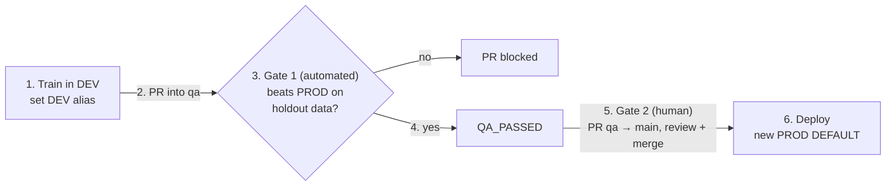

# sf-mlops

Snowflake MLOps CI/CD pipeline: a DEV → QA → PROD model promotion pattern
that has been developed and tested with **GitHub Actions** or **Azure DevOps Pipelines** as version control systems.

A human trains a model in a notebook against `MLOPS_DEV`, and two CI/CD
pipelines take it from there — evaluate in `MLOPS_QA`, then deploy to
`MLOPS_PROD`. No human holds the QA or PROD roles; only the pipelines write
there, authenticating with Workload Identity Federation (OIDC).

The detailed walkthrough behind this repo is on Medium:
[Git-Driven Model Promotion in Snowflake (WIP title)](BLOG_POST_URL). <!-- TODO: replace with the published URL -->

<!-- GitHub renders the mermaid block below; Azure Repos only shows the image above. -->



## Repo layout

```
setup/
├── common.sql                         -- platform-agnostic setup: warehouse, roles, DBs,
│                                         grants, datasets, log tables, human user
├── github/
│   ├── cicd.sql                       -- adds GitHub OIDC workload identities + network policy
│   └── README.md                      -- GitHub-specific prerequisites
└── azure-devops/
    ├── cicd.sql                       -- adds Azure DevOps OIDC workload identities + network policy
    └── README.md

notebooks/
└── train_model.ipynb                  -- trains LogisticRegression, moves DEV alias

scripts/
├── common.py                          -- shared Snowflake connection + model helpers
├── qa_evaluate.py                     -- evaluates DEV candidate against QA holdout
├── prod_deploy.py                     -- promotes QA_PASSED version to PROD
└── requirements.txt

.github/workflows/                     -- GitHub Actions pipelines
├── qa-eval.yml
└── prod-deploy.yml

azure-pipelines/                       -- Azure DevOps pipelines
├── qa-eval.yml
└── prod-deploy.yml
```

## Quick start

### 1. Run the common Snowflake setup

Run `setup/common.sql` as ACCOUNTADMIN. This creates the three databases,
roles, synthetic datasets, log tables, and the two CI/CD service users
(`MLOPS_QA_SVC`, `MLOPS_PROD_SVC`) — with no way to log in yet.
Platform-agnostic — do this regardless of which CI/CD system you use.

### 2. Run your platform-specific setup

Run one or more:

| Platform       | Setup file                    | README                                                       |
| -------------- | ----------------------------- | ------------------------------------------------------------ |
| GitHub Actions | `setup/github/cicd.sql`       | [setup/github/README.md](setup/github/README.md)             |
| Azure DevOps   | `setup/azure-devops/cicd.sql` | [setup/azure-devops/README.md](setup/azure-devops/README.md) |

Each file **adds** a named OIDC workload identity for that platform to the
same two service users (`ALTER USER ... ADD WORKLOAD IDENTITY`), so several
platforms can drive the same pipeline side by side. Each user can hold up to
10 identities.

### 3. Run the demo

1. Open `notebooks/train_model.ipynb` against `MLOPS_DEV` and run it. It sets
   the `DEV` alias (or a branch-specific alias such as `DEV_FEATURE_CHURN_V2`).
2. Open a PR into `qa` from `dev` or from your feature branch — the QA
   evaluation pipeline runs automatically and must pass before the PR merges.
3. Open a PR from `qa` into `main` and merge it — the PROD pipeline promotes
   the model. Do the whole promotion on one platform, then sync the other
   remote (see below).

## How a model gets from DEV to PROD

Data scientists train in `MLOPS_DEV` on `dev` or on their own feature branches,
and promotion is driven by pull requests. No version name, id, or metric is
ever passed through git or a pipeline parameter; everything is resolved live
from Model Registry **aliases**:

```
DEV alias (MLOPS_DEV)              -- set by the notebook; one alias per branch
   |  PR into `qa` triggers the QA pipeline
   v
QA_PASSED alias (MLOPS_QA)         -- set ONLY if the candidate beats the live
   |                                  PROD model on holdout data (required PR check)
   |  PR into `main`, reviewed, then merged
   v
DEFAULT version (MLOPS_PROD)       -- set ONLY by the PROD pipeline, which then
                                      clears QA_PASSED
```

`QA_PASSED` is a single alias, so one candidate can await promotion at a time.
Each hop is a real copy of the model between schemas
(`CREATE MODEL ... FROM MODEL ...`), not a reference back to the source.

## Who can write to QA and PROD

No human is granted `MLOPS_QA_ROLE` or `MLOPS_PROD_ROLE`. Only the two service
users (`MLOPS_QA_SVC`, `MLOPS_PROD_SVC`) hold them, created with no password
or key — `TYPE = SERVICE` blocks interactive login, and their only
authentication is an OIDC workload identity bound to one specific pipeline
stage. The only way around this is a break-glass admin role (ACCOUNTADMIN, or
SYSADMIN since the environment roles are rolled up to it); monitor those.

`MLOPS_DEV_ROLE` has no grants on the QA or PROD databases, so a data
scientist can't even resolve `MLOPS_QA.*` or `MLOPS_PROD.*`. (Test with
`USE SECONDARY ROLES NONE`, or privileges from your other roles still apply.)

## Platform comparison

|                          | GitHub Actions                                        | Azure DevOps                                                                                |
| ------------------------ | ----------------------------------------------------- | ------------------------------------------------------------------------------------------- |
| **OIDC issuer**          | `token.actions.githubusercontent.com`                 | `login.microsoftonline.com/<tenant>/v2.0` (older connections: `vstoken.dev.azure.com/<id>`) |
| **Environment binding**  | GitHub environment in the subject (`:environment:qa`) | Service connection ID in the subject                                                        |
| **Managed network rule** | `GITHUBACTIONS_GLOBAL`                                | None                                                                                        |
| **CLI integration**      | GA (`snowflake-actions@v3`)                           | Public preview                                                                              |

GitLab CI/CD isn't included yet. Adding it later means a `setup/gitlab/cicd.sql`
that adds `GITLAB_QA` / `GITLAB_PROD` workload identities (issuer
`https://gitlab.com`, subject `project_path:<group>/<project>:ref_type:branch:ref:<branch>`)
plus a `.gitlab-ci.yml` — no changes to `common.sql` or the scripts' auth.
Also add `CI_PIPELINE_ID` to the run-ID fallbacks in `qa_evaluate.py` /
`prod_deploy.py` (GitLab already sets `CI_COMMIT_SHA`).

## Scripts are platform-agnostic

`scripts/common.py`, `qa_evaluate.py`, and `prod_deploy.py` use the same
OIDC token flow (`SNOWFLAKE_TOKEN` env var + `authenticator=WORKLOAD_IDENTITY`)
regardless of which CI platform sets that env var. The log tables use
`CI_RUN_ID` / `CI_COMMIT_SHA` columns, and each script auto-detects the
correct env var for each platform.
